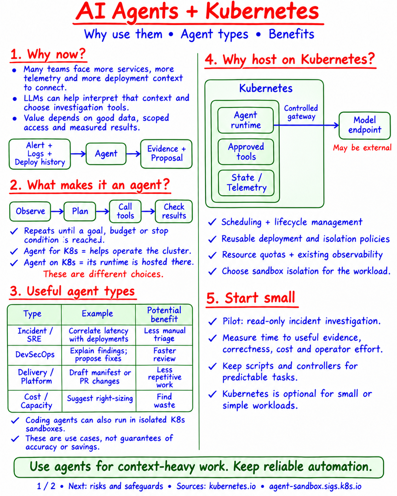
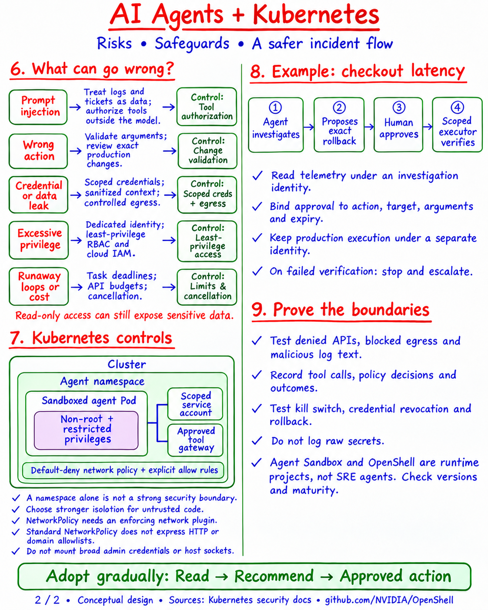

# AI Agents and Kubernetes

> An AI agent uses a model to choose tool-assisted steps; Kubernetes can host its runtime or be the infrastructure it helps operate.

Before giving an agent a tool, decide what happens when it chooses the wrong action.

## What is it?

- **Agent:** a system in which a model chooses actions and tool use dynamically. A **workflow** instead follows a predefined control path; either can be appropriate. [Anthropic's architectural distinction](https://www.anthropic.com/engineering/building-effective-agents)
- **Tool:** a callable capability such as retrieving logs, querying metrics or proposing a deployment change. The surrounding application determines which capabilities are available. [Agent building blocks](https://www.anthropic.com/engineering/building-effective-agents)
- **Agent for Kubernetes:** an operational assistant that reads or acts on cluster resources. **Agent on Kubernetes:** an agent runtime hosted in the cluster. These are different design choices; hosting location does not determine authority.
- **ServiceAccount/RBAC:** workload identity and Kubernetes API permissions. **Sandbox:** an execution environment with isolation appropriate to its threat model. A namespace alone is not a strong security boundary. [RBAC guidance](https://kubernetes.io/docs/concepts/security/rbac-good-practices/) · [Agent Sandbox overview](https://agent-sandbox.sigs.k8s.io/docs/getting_started/)

## Why does it matter today?

- Tool-using models can perform multi-step tasks instead of returning only text. This makes operational assistance possible, but expands the consequences of incorrect output. [Agent patterns](https://www.anthropic.com/engineering/building-effective-agents) · [OWASP excessive agency](https://genai.owasp.org/llmrisk/llm062025-excessive-agency/)
- **Consider an agent when:** investigation needs flexible choices among tools and the results can be checked against evidence. Start with a bounded, read-only task; expand only after evaluation.
- **Use a deterministic workflow instead when:** the steps are known, repeatability matters more than flexibility, or errors cannot be reliably detected. Agents can introduce extra latency, cost and compounding errors. [When to use agents](https://www.anthropic.com/engineering/building-effective-agents)
- **Use Kubernetes hosting when:** its workload lifecycle and sandbox orchestration fit your platform. A small assistant does not automatically need a Kubernetes deployment. [Agent Sandbox lifecycle](https://agent-sandbox.sigs.k8s.io/docs/)

## Where can I use it?

- **Proposed incident investigation:** collect logs, metrics and recent deployment context; produce a cited hypothesis for an operator to verify.
- **Proposed security review:** explain findings and draft remediation for review rather than directly granting new privileges.
- **Proposed platform assistance:** prepare manifest changes or pull requests; submit them through existing review and policy checks.
- **Proposed cost analysis:** investigate utilization and suggest changes; validate workload impact before applying them. These are design examples, not claims of measured savings or verified production deployments.
- **Runtime option: Agent Sandbox.** Provides sandbox lifecycle resources and supports secure runtimes such as gVisor or Kata Containers. It is infrastructure for execution, not a complete SRE agent. [Project documentation](https://agent-sandbox.sigs.k8s.io/docs/)
- **Runtime option: OpenShell.** Provides an agent execution environment and policy controls. Check the specific release and deployment path: NVIDIA's Kubernetes setup documentation labels its Helm chart experimental. [Official Kubernetes setup](https://docs.nvidia.com/openshell/latest/kubernetes/setup)
- **Production evidence:** the examples here describe proposed operational patterns. They should not be presented as named production success stories without a directly cited deployment report.

## How does it work?

The following is a recommended reference workflow, not a guarantee supplied by a particular product.

1. **Receive a bounded task:** input an incident identifier, allowed environment, time window and completion criteria.
2. **Gather evidence:** approved tools return relevant observations. Treat retrieved logs, tickets and documents as untrusted data. [Prompt injection risks](https://genai.owasp.org/llmrisk/llm01-prompt-injection/)
3. **Investigate:** the model chooses another permitted query or produces a hypothesis; the application enforces tool limits and termination. [Agent control loop](https://www.anthropic.com/engineering/building-effective-agents)
4. **Propose a change:** output the exact operation, target, arguments, evidence and expected outcome. A proposal is not authorization.
5. **Authorize independently:** policy checks and a human approval step gate consequential actions. Keep permission checks outside model reasoning. [Excessive agency mitigations](https://genai.owasp.org/llmrisk/llm062025-excessive-agency/)
6. **Execute and verify:** a separately scoped executor acts, records the result, checks service health and stops or escalates on failure.

```text
Alert / task
    |
    v
Investigation agent --> Approved read tools --> Evidence
    |
    v
Exact proposal --> Policy check --> Human approval
                                        |
                                        v
                                Scoped executor
                                        |
                                        v
                              Verify / stop / escalate

Untrusted retrieved text never grants permissions.
```

- **Kubernetes responsibilities:** run the agent workload, enforce configured API permissions and provide supported network controls. A model endpoint can be outside the cluster. [RBAC](https://kubernetes.io/docs/concepts/security/rbac-good-practices/) · [NetworkPolicy](https://kubernetes.io/docs/concepts/services-networking/network-policies/)
- [Illustrated concepts and agent types](notes-page-1.png) · [Risk-management diagram](notes-page-2.png)

## What can go wrong?

- **Prompt injection:** malicious instructions embedded in retrieved content can influence the model. Filtering input alone does not establish authorization. [OWASP prompt injection](https://genai.owasp.org/llmrisk/llm01-prompt-injection/)
- **Excessive agency:** broad tools, permissions or autonomy can convert an incorrect answer into a damaging action. [OWASP excessive agency](https://genai.owasp.org/llmrisk/llm062025-excessive-agency/)
- **Indirect privilege escalation:** permission to create workloads can expose namespace credentials or enable use of other ServiceAccounts. “No cluster-admin” is not a complete access review. [RBAC escalation risks](https://kubernetes.io/docs/concepts/security/rbac-good-practices/)
- **Incomplete network isolation:** NetworkPolicy requires an enforcing network implementation. The standard API controls network connections, not arbitrary HTTP operations or domain-based application authorization. [NetworkPolicy scope](https://kubernetes.io/docs/concepts/services-networking/network-policies/)
- **Operational cost and uncertainty:** repeated tool calls, stale evidence, latency and incorrect conclusions can make an agent less useful than a deterministic workflow. [Agent tradeoffs](https://www.anthropic.com/engineering/building-effective-agents)
- **Data exposure:** even read-only tools may return sensitive information; unauthorized disclosure is a possible consequence of prompt injection. [OWASP threat examples](https://genai.owasp.org/llmrisk/llm01-prompt-injection/)

## How do we handle those risks?

- **Scope identity:** dedicate workload identities, minimize verbs/resources and avoid wildcard grants. Disable automatic ServiceAccount token mounting when API access is unnecessary. [RBAC practices](https://kubernetes.io/docs/concepts/security/rbac-good-practices/)
- **Restrict execution:** apply suitable Pod Security controls; avoid privileged workloads, host access and unnecessary capabilities. Use a stronger sandbox runtime for untrusted generated code. [Pod Security Standards](https://kubernetes.io/docs/concepts/security/pod-security-standards/) · [Sandbox runtimes](https://agent-sandbox.sigs.k8s.io/docs/getting_started/)
- **Constrain network paths:** start with explicit allowed destinations and verify denial tests. Use application-layer gateways when requirements exceed standard NetworkPolicy semantics. [NetworkPolicy](https://kubernetes.io/docs/concepts/services-networking/network-policies/)
- **Bind approval to the action:** as a recommended design, approval should specify target, operation, parameters and expiry; the executor must reject anything outside it. Separate the proposing identity from the executing identity. [Least functionality and human approval guidance](https://genai.owasp.org/llmrisk/llm062025-excessive-agency/)
- **Set application budgets:** recommended controls include tool-call limits, API-spend limits, deadlines and cancellation. CPU/memory quotas alone do not control remote model expenditure.
- **Validate adversarially:** test malicious log text, denied API calls, blocked egress, stale evidence and revoked credentials. Evaluate correctness and time-to-useful-evidence against the existing workflow before expanding access. [Prompt injection mitigation guidance](https://genai.owasp.org/llmrisk/llm01-prompt-injection/)
- **Observe and recover:** record tool requests, policy decisions and outcomes without raw secrets. Provide a kill switch, credential revocation and a tested recovery procedure. Kubernetes audit events help reconstruct API activity, but do not replace application-level tool traces. [Kubernetes auditing](https://kubernetes.io/docs/tasks/debug/debug-cluster/audit/)

## Where can I learn more?

- [Building effective agents](https://www.anthropic.com/engineering/building-effective-agents) — agent/workflow distinctions and design patterns.
- [Agent Sandbox documentation](https://agent-sandbox.sigs.k8s.io/docs/) — lifecycle resources and runtime integration.
- [NVIDIA OpenShell setup](https://docs.nvidia.com/openshell/latest/kubernetes/setup) — deployment-specific requirements and maturity caveats.
- [Kubernetes security checklist](https://kubernetes.io/docs/concepts/security/security-checklist/) — baseline platform controls.
- [OWASP prompt injection](https://genai.owasp.org/llmrisk/llm01-prompt-injection/) and [excessive agency](https://genai.owasp.org/llmrisk/llm062025-excessive-agency/) — threats and mitigations.

## Illustrated notes




