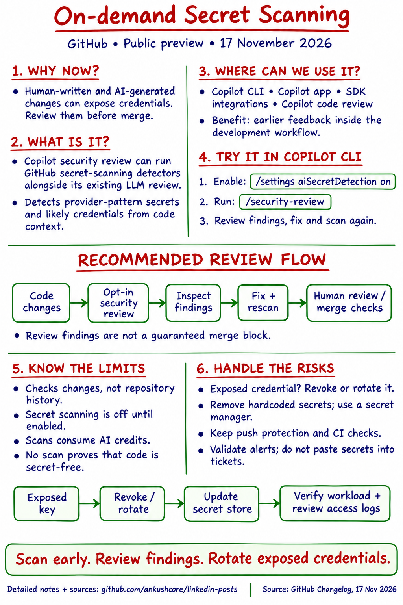

# On-demand secret scanning for developers and agents

> An opt-in Copilot security-review capability that checks code changes for exposed credentials using GitHub secret-scanning detectors.

A clean diff should not contain the keys to production.

## What is it?

- GitHub announced this **public preview on 17 November 2026**. It adds secret-scanning detectors to Copilot security review; the review already had LLM-based detection. [Announcement](https://github.blog/changelog/2026-11-17-secret-scanning-on-demand-for-developers-and-agents/)
- A **secret** is a credential such as a token, password or API key. Exposure can allow unauthorized access within that credential's permissions. [Secret scanning concepts](https://docs.github.com/en/code-security/concepts/secret-security/secret-scanning)
- Keep three controls distinct: on-demand review examines **changes**; repository secret scanning examines Git history across branches; push protection can block supported secrets during a push. [Review scope](https://github.blog/changelog/2026-11-17-secret-scanning-on-demand-for-developers-and-agents/), [repository scanning](https://docs.github.com/en/code-security/concepts/secret-security/secret-scanning), [push protection](https://docs.github.com/en/code-security/concepts/secret-security/push-protection)

## Why does it matter today?

- Both people and coding agents can introduce credentials. Running a review before merge moves feedback into the development workflow. The new integration supports both kinds of contributors. [Announcement](https://github.blog/changelog/2026-11-17-secret-scanning-on-demand-for-developers-and-agents/)
- **Use it** as an additional review layer when your team already uses a supported Copilot surface.
- **Do not use it as a replacement** for historical scanning, credential incident response or an enforced merge policy. These recommendations follow from its change-only scope and the separate roles of repository scanning and push protection. [Scope](https://github.blog/changelog/2026-11-17-secret-scanning-on-demand-for-developers-and-agents/), [protection model](https://docs.github.com/en/code-security/concepts/secret-security/push-protection)

## Where can I use it?

- Supported surfaces: Copilot CLI, Copilot app, Copilot SDK integrations and Copilot code review. Availability requires access to the corresponding review feature. [Supported surfaces and billing](https://github.blog/changelog/2026-11-17-secret-scanning-on-demand-for-developers-and-agents/)
- Illustrative uses: checking a new database connection configuration, reviewing an agent-generated integration, or reviewing authentication changes in a pull request. These are proposed workflows, not claims about named production adopters.
- Benefit compared with a separate manual review step: developers can request detection within an existing Copilot workflow. Keep independent controls where you require enforcement. [Integration details](https://github.blog/changelog/2026-11-17-secret-scanning-on-demand-for-developers-and-agents/)

## How does it work?

1. Enable the integration on the surface you use; it is off by default.
2. Request security review of your changes.
3. Detectors look for provider-specific patterns and likely credentials inferred from surrounding code.
4. Inspect findings, fix the underlying issue and request another review. [Mechanism and setup](https://github.blog/changelog/2026-11-17-secret-scanning-on-demand-for-developers-and-agents/)

For an interactive **Copilot CLI** session:

```text
/settings aiSecretDetection on
/security-review
```

In the **Copilot app**, enable AI secret detection under Settings → Experimental. For **Copilot code review**, enable Secret scanning under the repository's Settings → Copilot → Code review → Security, then request review. These are separate surface-specific settings. [Official instructions](https://github.blog/changelog/2026-11-17-secret-scanning-on-demand-for-developers-and-agents/)

Recommended workflow; the final gate must be configured independently:

```text
Human or agent changes
          |
          v
Opt-in security review ---> Findings
                              |
                              v
                      Human assessment
                              |
                              v
                       Fix and rescan
                              |
                              v
                  Required checks / review
                              |
                              v
                            Merge
```

## What can go wrong?

- **History blind spot:** this review does not search repository history. A clean result cannot resolve previous exposure. [Review scope](https://github.blog/changelog/2026-11-17-secret-scanning-on-demand-for-developers-and-agents/)
- **Setup confusion:** requesting security review without opting in leaves the pre-existing LLM-based detection in use. [Enablement](https://github.blog/changelog/2026-11-17-secret-scanning-on-demand-for-developers-and-agents/)
- **Detection and enforcement confusion:** a review finding is not itself a guaranteed merge block. Use explicit controls; push protection has its own supported patterns and configuration. [Push protection](https://docs.github.com/en/code-security/concepts/secret-security/push-protection)
- **Cost and compatibility:** scans consume AI credits. The integration is a public preview, so confirm current settings and billing before broad rollout. [Availability and billing](https://github.blog/changelog/2026-11-17-secret-scanning-on-demand-for-developers-and-agents/)
- **Incomplete remediation:** deleting a credential from code does not revoke it. GitHub recommends promptly rotating exposed credentials. [Remediation guidance](https://docs.github.com/en/code-security/concepts/secret-security/secret-scanning)
- **Operational risk assessment:** missed detections, noisy findings, repeated review latency and careless copying of credentials into tickets can undermine the workflow. Do not interpret an empty findings list as proof of safety or assume unlimited throughput.

## How do we handle those risks?

- **Layer controls:** retain repository history scanning and configured push protection. Assign an owner to assess findings and exceptions. [History coverage](https://docs.github.com/en/code-security/concepts/secret-security/secret-scanning), [push protection](https://docs.github.com/en/code-security/concepts/secret-security/push-protection)
- **Respond to exposure:** revoke or rotate the credential, update dependent workloads, and check for unauthorized use. An inactive credential does not prove that no misuse occurred. [Alert evaluation](https://docs.github.com/en/code-security/tutorials/remediate-leaked-secrets/evaluating-alerts)
- **Recommended validation:** test enablement in a disposable repository with nonfunctional test fixtures; confirm expected findings and document unsupported cases. Never create a real credential leak just to test detection.
- **Recommended monitoring:** track review failures, unresolved findings, remediation time, exceptions and credit consumption. Report credential identifiers or redacted locations, not raw values.
- **Recommended recovery:** after rotation, test affected workloads and watch authentication errors. If a replacement fails, repair its configuration or issue another replacement; do not restore an exposed key to regain service.
- **Recommended governance:** store runtime credentials in a secret manager, minimize permissions, restrict access to findings and define who can approve exceptions. Review data-handling requirements before enabling new integrations.

```text
Exposure found
      |
      v
Revoke / rotate --> Update secret store --> Update workload
                                                |
                                                v
                                  Verify health + inspect access logs
```

## Where can I learn more?

- [GitHub launch announcement](https://github.blog/changelog/2026-11-17-secret-scanning-on-demand-for-developers-and-agents/): preview scope, commands, supported surfaces and billing.
- [Secret scanning concepts](https://docs.github.com/en/code-security/concepts/secret-security/secret-scanning): historical coverage and remediation.
- [Push protection concepts](https://docs.github.com/en/code-security/concepts/secret-security/push-protection): blocking supported secrets at push time.
- [Evaluating alerts](https://docs.github.com/en/code-security/tutorials/remediate-leaked-secrets/evaluating-alerts): validity checks and prioritization; support varies by credential type and plan.

## Illustrated notes


