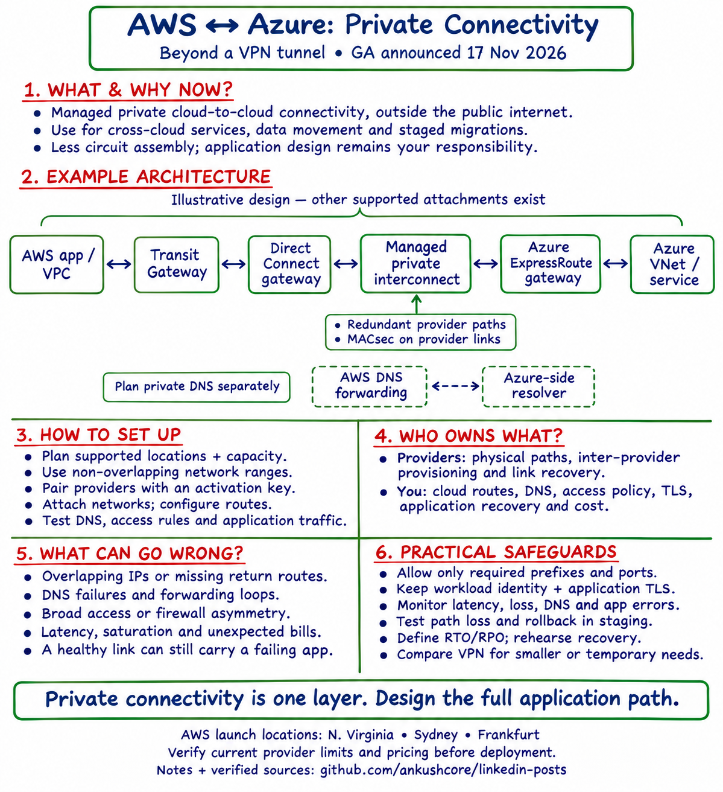

# Connecting AWS and Azure privately: architecture beyond a VPN tunnel

> AWS Interconnect – multicloud and Azure Multicloud Interconnect provide a managed private network path between workloads in the two clouds.

A working link is only the beginning of a working application.

## What is it?

- AWS announced Azure connectivity as generally available on **17 November 2026**. Microsoft independently confirmed the same release. [AWS announcement](https://aws.amazon.com/about-aws/whats-new/2026/11/aws-announces-AWS-interconnect-multicloud-azure-ga/), [Microsoft announcement](https://techcommunity.microsoft.com/blog/AzureNetworkingBlog/connecting-clouds-and-the-last-mile-with-azure/4573283)
- A **VPC** is your AWS virtual network; a **VNet** is its Azure counterpart. The managed connection joins these environments without carrying inter-cloud traffic over the public internet. Azure uses ExpressRoute as its underlying connectivity technology. [Azure overview](https://learn.microsoft.com/en-us/azure/multicloud-interconnect/overview)
- An **activation key** pairs the provider-side resources. AWS uses a **Direct Connect gateway** as its attach point; supported AWS network attachments include Transit Gateway, virtual private gateway and Cloud WAN. [AWS architecture](https://docs.aws.amazon.com/interconnect/latest/userguide/what-is-interconnect.html)

## Why does it matter today?

- Distributed applications, staged migrations and data services can create persistent dependencies across providers. The managed service reduces the circuit, router and provider-coordination work customers previously assembled themselves. It does not remove customer responsibility for application architecture or recovery. [Microsoft GA explanation](https://techcommunity.microsoft.com/blog/AzureNetworkingBlog/connecting-clouds-and-the-last-mile-with-azure/4573283)
- **Recommended use:** evaluate it when a workload has a sustained private-connectivity requirement and its latency, throughput and location needs fit the service.
- **Recommended alternative:** compare a site-to-site VPN for smaller or temporary requirements. Avoid adding a second cloud solely because a managed connection exists; first establish the workload benefit and operating cost.

## Where can I use it?

- Illustrative scenarios: an AWS application calling an Azure-hosted private service; bulk data transfer during a migration; replication traffic supporting a separately designed recovery plan. These are examples, not named customer deployments.
- The AWS launch names **N. Virginia, Sydney and Frankfurt**. Verify the compatible Azure location and network attachment before provisioning. [Launch scope](https://aws.amazon.com/about-aws/whats-new/2026/11/aws-announces-AWS-interconnect-multicloud-azure-ga/)
- Azure supports VNet connections through an ExpressRoute gateway and documents a Virtual WAN attachment workflow. Provider support and region availability must be checked together. [Azure availability](https://learn.microsoft.com/en-us/azure/multicloud-interconnect/availability-limits)

## How does it work?

Illustrative Transit Gateway design; the arrows show connectivity, not a claim that every product is required:

```text
AWS application / VPC
          |
    Transit Gateway
          |
 Direct Connect gateway
          |
   AWS managed edge
          ||
          || Managed private interconnect
          || Redundant provider paths; link MACsec
          ||
   Azure managed edge
          |
 ExpressRoute gateway
          |
Azure VNet / private service

Separate design: DNS forwarding + access policy + application TLS
```

1. **Plan:** select a supported location, capacity, non-overlapping address ranges and cloud attachments.
2. **Pair:** create the resources and redeem the activation key on the other provider. Verify account, location and capacity details.
3. **Attach:** connect the cloud networks and apply intended routes.
4. **Validate:** test name resolution, allowed application traffic, denied traffic and failure handling before moving production traffic. Steps 1 and 4 are recommended rollout checks; pairing and attachment follow the provider model. [Azure provisioning model](https://learn.microsoft.com/en-us/azure/multicloud-interconnect/overview)

AWS describes redundant paths across separate facilities, with MACsec between adjacent provider network devices. That encryption boundary is distinct from a TLS session between application endpoints. Retaining application TLS is our recommended safeguard. [AWS architecture](https://docs.aws.amazon.com/interconnect/latest/userguide/what-is-interconnect.html)

## What can go wrong?

- **Address overlap or route scale:** Azure requires non-overlapping networks and documents a 250-prefix maximum per connection; exceeding it interrupts connectivity. Validate both providers' limits. [Requirements](https://learn.microsoft.com/en-us/azure/multicloud-interconnect/availability-limits)
- **DNS gaps:** IP connectivity does not configure cross-cloud private name resolution. Route 53 forwarding requires rules and reachable target resolvers. Unreachable targets can increase resolution time. [Route 53 forwarding](https://docs.aws.amazon.com/Route53/latest/DeveloperGuide/resolver-forwarding-outbound-queries.html)
- **Operational risks to assess:** asymmetric routing through stateful firewalls, overly broad network access, cross-cloud latency, link saturation and failed application retries.
- **Recovery assumptions:** redundant provider paths do not define database consistency, application failover or recovery objectives. Customers retain recovery responsibility. [Ownership boundaries](https://techcommunity.microsoft.com/blog/AzureNetworkingBlog/connecting-clouds-and-the-last-mile-with-azure/4573283)
- **Cost and documentation:** Azure charges vary by location, SKU and capacity; the other provider may bill separately. The availability page contains both GA tables and older preview wording. Confirm current deployment details; do not treat the old 1-Gbps preview statement as the universal GA ceiling. [Availability and pricing guidance](https://learn.microsoft.com/en-us/azure/multicloud-interconnect/availability-limits)

## How do we handle those risks?

The following are recommended implementation controls:

- **Addressing and routes:** inventory prefixes, reserve disjoint ranges, advertise only required networks and validate forward and return paths. Review route changes as code where possible.
- **DNS:** define private-zone ownership and conditional forwarding. For AWS-to-Azure resolution, forward only the intended suffixes to reachable Azure-side resolvers; design the reverse direction separately. Avoid forwarding loops. [Forwarding rules](https://docs.aws.amazon.com/Route53/latest/DeveloperGuide/resolver-forwarding-outbound-queries.html)
- **Security:** restrict ports and peers using cloud network controls; preserve workload identity and TLS. Protect activation keys and limit who can change attachments or routes.
- **Monitoring:** measure application success rate and latency alongside packet loss, throughput, gateway health, DNS failures and cost. A healthy link alone is insufficient evidence of a healthy service.
- **Testing:** use a representative staging workload, including large transfers, denied flows, DNS failures and controlled path-loss exercises. Verify behavior under reduced capacity.
- **Recovery:** define RTO/RPO, owners and rollback criteria. Rehearse restoring the previous route or application endpoint. A backup VPN is an optional engineered path, not an automatic feature; test its capacity and route preference if used.
- **Cost:** estimate both sides, attachments, resolvers, logging and applicable transfer charges; budget against measured traffic before committing to a production design.

## Where can I learn more?

- [AWS GA announcement](https://aws.amazon.com/about-aws/whats-new/2026/11/aws-announces-AWS-interconnect-multicloud-azure-ga/) — date and AWS launch locations.
- [Microsoft GA announcement](https://techcommunity.microsoft.com/blog/AzureNetworkingBlog/connecting-clouds-and-the-last-mile-with-azure/4573283) — operational ownership and release context.
- [AWS Interconnect architecture](https://docs.aws.amazon.com/interconnect/latest/userguide/what-is-interconnect.html) — attach points, redundancy and encryption.
- [Azure service overview](https://learn.microsoft.com/en-us/azure/multicloud-interconnect/overview) — pairing and VNet attachment.
- [Azure availability and limits](https://learn.microsoft.com/en-us/azure/multicloud-interconnect/availability-limits) — provider-specific requirements; contains residual preview wording.
- [Route 53 outbound forwarding](https://docs.aws.amazon.com/Route53/latest/DeveloperGuide/resolver-forwarding-outbound-queries.html) — DNS rules and reachability requirements.

## Illustrated notes


