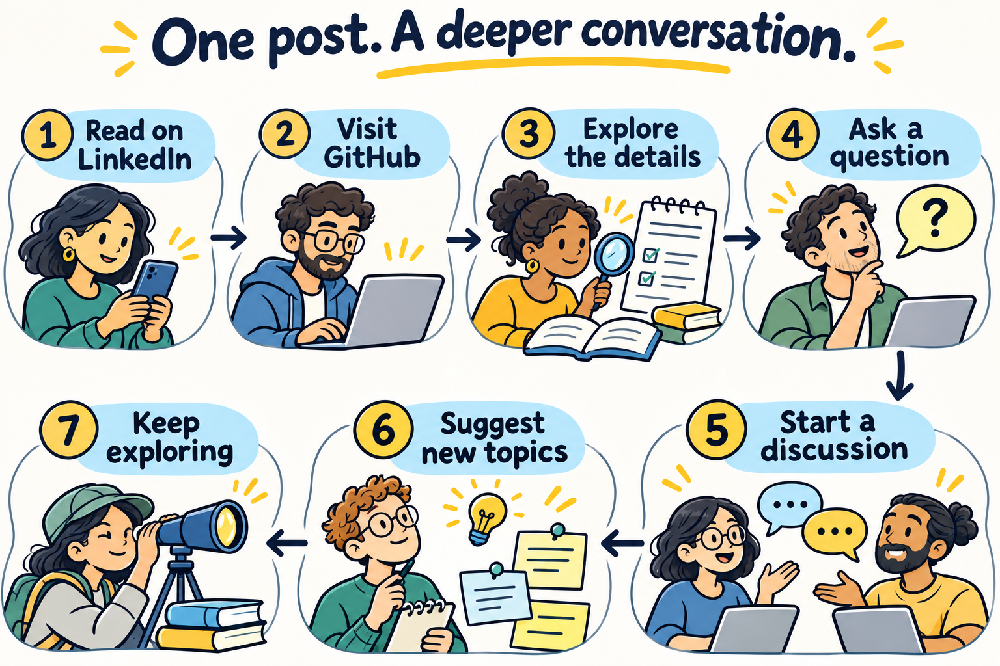

# Learn. Question. Build better systems.

### Daily illustrated notes on DevOps, DevSecOps, SRE, cloud & databases

Welcome! I'm **Ankush**. I share practical technology explanations on LinkedIn, and this repository is where you can explore each topic in more detail—with visual notes, examples, sources and room for discussion.

We're building a growing learning library, one topic at a time. Whether you're learning a concept, preparing for an interview or weighing a production design, start with a topic that makes you curious.

**[Browse the index](#topic-index) · [Ask a question](https://github.com/ankushcore/linkedin-posts/discussions/new?category=q-a) · [Suggest a topic](https://github.com/ankushcore/linkedin-posts/discussions/new?category=ideas)**

## From a LinkedIn post to a deeper conversation

The post starts the conversation. The notes add context. Your questions and experiences help shape what comes next.

## Topic index

Pick a topic to open its notes, caption and sources. New entries are added here as we prepare daily content; the detailed material stays inside each post's folder.

<!-- TOPIC_INDEX_START -->
| Date | Topic | Explore |
| --- | --- | --- |
| 19 Nov 2026 | AWS–Azure private connectivity: architecture, risks & safeguards | [Read the notes →](2026-11-19/aws-azure-private-interconnect/) |
| 18 Nov 2026 | On-demand secret scanning: setup, limits & credential response | [Read the notes →](2026-11-18/on-demand-secret-scanning/) |
| 17 Nov 2026 | PostgreSQL on Kubernetes: architecture, tradeoffs & recovery | [Read the notes →](2026-11-17/postgres-kubernetes/) |
| 16 Nov 2026 | AI Agents and Kubernetes: uses, risks & safeguards | [Read the notes →](2026-11-16/secure-agents/) |
<!-- TOPIC_INDEX_END -->

*Organized as `YYYY-MM-DD/post-name/`. Dates are content dates.*

## What you will find in every topic

| Your question | What we cover |
| --- | --- |
| **What is it?** | A plain-language explanation and the background you need. |
| **Why does it matter today?** | The modern problem it addresses—and when you actually need it. |
| **Where can I use it?** | Practical examples, options and benefits. |
| **How does it work?** | Short illustrated notes and diagrams you can follow. |
| **What can go wrong?** | Risks, limitations and tradeoffs. |
| **How do we handle those risks?** | Concrete safeguards, validation and recovery practices. |
| **Where can I learn more?** | Original sources and links for further reading. |

The aim is useful understanding you can question and apply. Visuals are digitally created in a handwritten style and reviewed for clarity and technical accuracy.

## Join the conversation

### 💡 Open suggestion box

What should we explain next? Suggest a topic, request a comparison or tell us which diagram would help you understand something better.

**[Open the suggestion form →](https://github.com/ankushcore/linkedin-posts/discussions/new?category=ideas)** · [Browse ideas](https://github.com/ankushcore/linkedin-posts/discussions/categories/ideas)

### ❓ Open question box

Stuck on a concept? Link the post, explain the confusing part and ask your question. Beginner questions are welcome.

**[Open the question form →](https://github.com/ankushcore/linkedin-posts/discussions/new?category=q-a)** · [Explore Q&A](https://github.com/ankushcore/linkedin-posts/discussions/categories/q-a)

### 💬 Open discussion forum

Share a real-world experience, compare approaches, challenge an assumption or discuss a tradeoff with other readers.

**[Start a discussion →](https://github.com/ankushcore/linkedin-posts/discussions/new?category=general)** · [Browse all discussions](https://github.com/ankushcore/linkedin-posts/discussions)

Sign in to GitHub to participate. Keep conversations respectful, include useful context and leave credentials or private production data out of examples.

## Keep exploring

- ⭐ **Star the repository** to keep the library within reach.
- 📚 **Choose your next topic** from the [index](#topic-index).
- 🗣️ **Join a conversation** and share what worked—or failed—in your environment.
- 💡 **Suggest an idea** that could become a future post.
- 🔗 **Share a useful note** with a teammate or someone learning the topic.

**Come for a post. Stay for the understanding. Help shape the next idea.**
