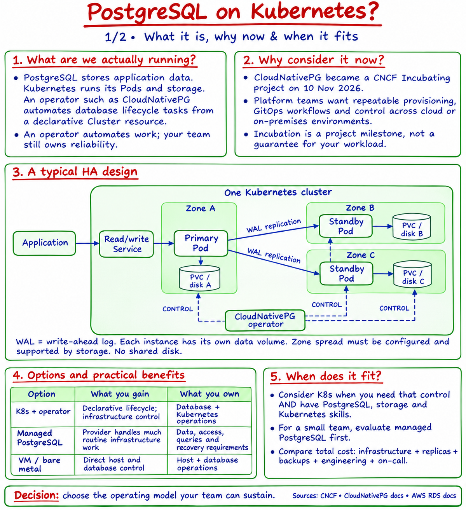
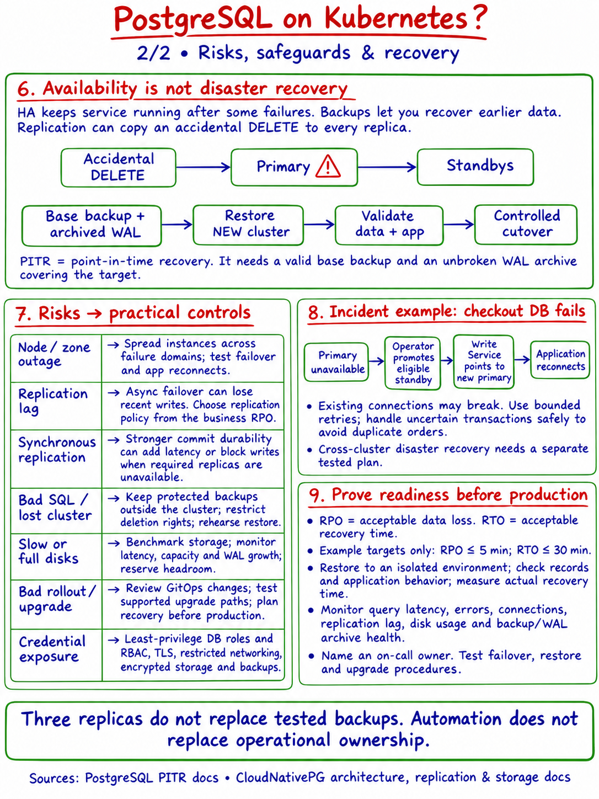
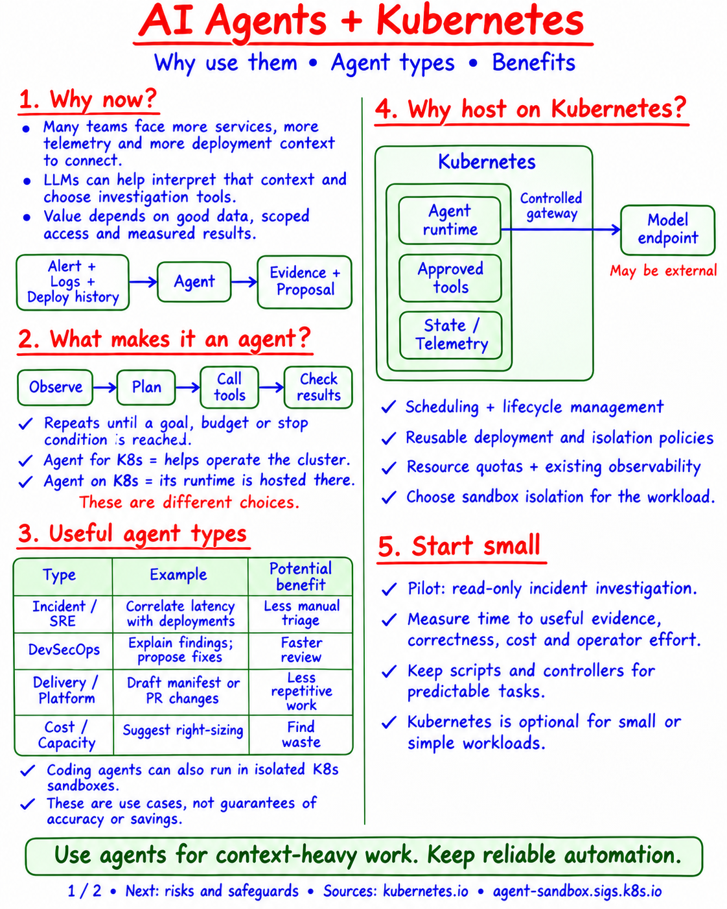
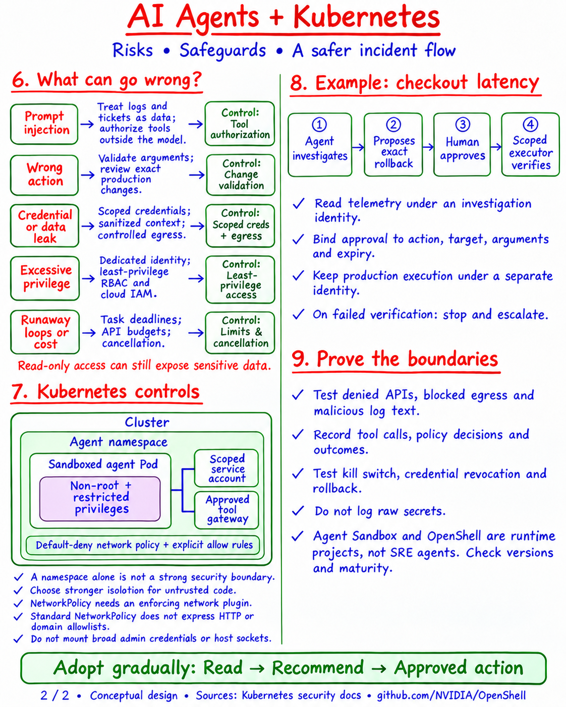

# Understand the system. See the tradeoffs.

### Illustrated field notes on DevOps, SRE, cloud & databases

What happens when your database primary fails? How much access should an AI agent have in production? And how do you recover when automation gets something wrong?

I'm **Ankush**, and this is my collection of visual explanations for engineers who want to understand how things work—and what can go wrong. Start with a question, follow the diagram, then explore the decisions behind it.

**Handwritten-style notes · Practical examples · Risks & safeguards · Original sources**

---

## Pick a question

| What are you trying to understand? | Start here |
| --- | --- |
| Should my PostgreSQL database run inside Kubernetes? | [Architecture, operating choices & recovery](#postgresql-on-kubernetes) |
| Can AI agents help operate Kubernetes safely? | [Agent types, benefits & boundaries](#ai-agents-and-kubernetes) |

## PostgreSQL on Kubernetes

**Three database instances. Three zones. One accidental DELETE. What happens next?**

Replication and backups solve different problems. These notes explain the architecture, compare Kubernetes with managed databases, and walk through failover and recovery.

- Understand the primary, standbys, operator and separate storage volumes.
- Weigh operational control against the work your team must own.
- Connect each risk to a safeguard—and test whether recovery meets your targets.

[**Page 1: Architecture & decisions →**](2026-11-17-postgres-kubernetes-notes-page-1.png) · [**Page 2: Risks & recovery →**](2026-11-17-postgres-kubernetes-notes-page-2.png)

<strong>See the risk-management and recovery page</strong>

[Read the post](2026-11-17-postgres-kubernetes-caption.txt) · [Check the sources](2026-11-17-postgres-kubernetes-sources.md)

*17 November 2026 · Database reliability · Kubernetes · Disaster recovery*

---

## AI Agents and Kubernetes

**An agent can investigate an alert. Should it also be allowed to change production?**

Explore the difference between agents that operate Kubernetes and agents hosted on Kubernetes. Then follow an incident from investigation to an approved, controlled action.

- Compare incident, security, delivery and cost-analysis use cases.
- Understand prompt injection, excessive permissions and runaway tool use.
- Design controls outside the model: scoped identities, isolation, approval and rollback.

[**Page 1: Why agents & which types →**](2026-11-16-secure-agents-notes-page-1.png) · [**Page 2: Risks & guardrails →**](2026-11-16-secure-agents-notes-page-2.png)

<strong>See the risks and guardrails page</strong>

[Read the post](2026-11-16-secure-agents-caption.txt) · [Check the sources](2026-11-16-secure-agents-sources.md)

*16 November 2026 · SRE · DevSecOps · AI agents*

---

## What you'll find in every topic

**What it is → Why it matters now → Where it helps → What can go wrong → How to manage the risks**

Each explanation combines a practical example, readable diagrams and sources you can explore further. Benefits come with tradeoffs; illustrative targets are not production guarantees.

Everything lives in this repository's main directory. Filenames start with the content date and topic, so notes, captions and sources are easy to match. The visuals are digitally generated in a handwritten style and reviewed for clarity and technical accuracy.

## Keep exploring

⭐ **Star this repository** to keep the notes handy.

💬 **Have a correction or a topic suggestion?** [Open an issue](https://github.com/ankushcore/linkedin-posts/issues) and share the question you'd like explained.

🔗 **Share a useful page** with someone learning the topic or preparing for a design discussion.

Content and publication status

Dates identify when content was prepared, in Asia/Kolkata. Both current posts are drafts awaiting final LinkedIn approval; a repository upload does not mean a post has been published. Each topic's status JSON records its publication state.

